# Screenshot gallery

ComicViewer v1.4.0 on Android 16, using public-domain sample comics.
Select an image to view it at full resolution. See [capture details and artwork
credits](STORE-ASSETS.md) for sources and screenshot specifications.

## Library and appearance

<table>
  <tr>
    <td align="center"><a href="screenshots/title-library.png">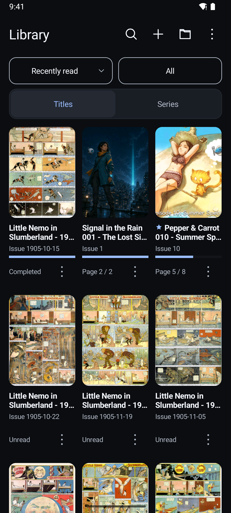</a> Titles and progress</td>
    <td align="center"><a href="screenshots/light-library.png">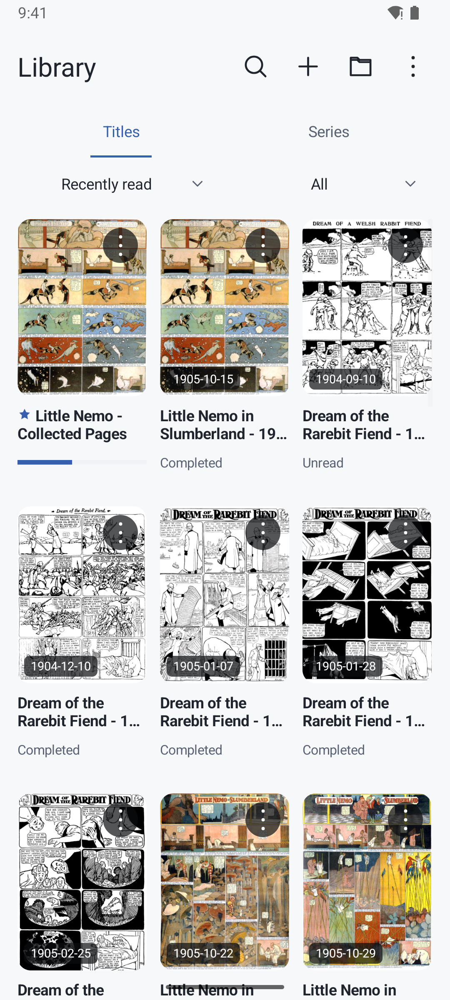</a> Light appearance</td>
    <td align="center"><a href="screenshots/series-library.png">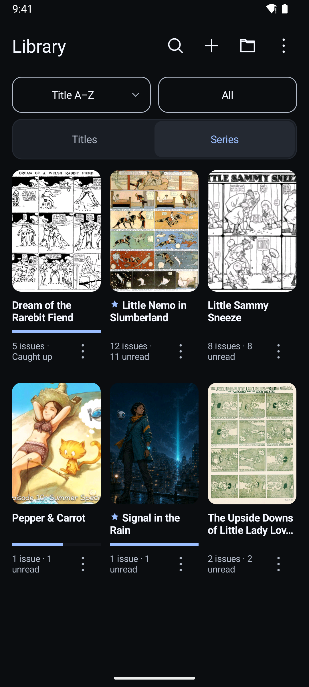</a> Series and favorites</td>
  </tr>
</table>

## Reading

<table>
  <tr>
    <td align="center"><a href="screenshots/paged-reading.png">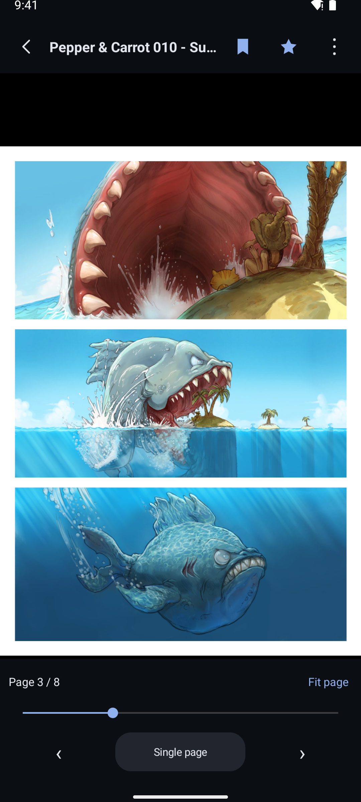</a> Single-page reading</td>
    <td align="center"><a href="screenshots/continuous-scroll.png">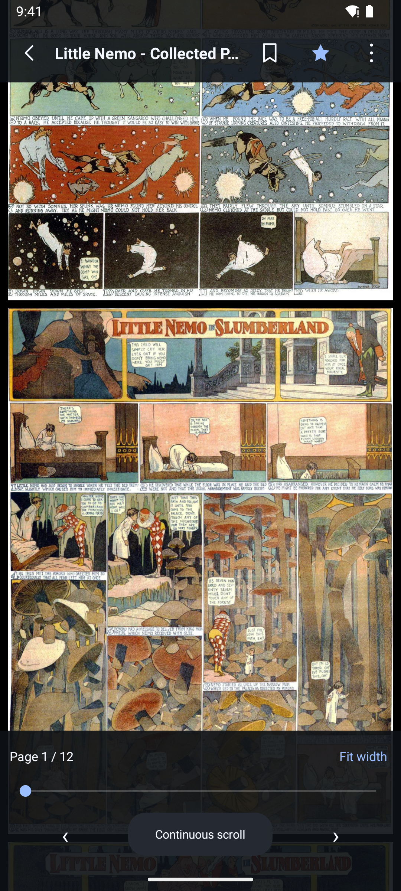</a> Continuous scrolling</td>
    <td align="center"><a href="screenshots/continuous-series.png">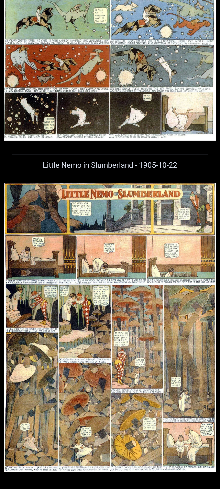</a> Continuous series reading</td>
  </tr>
</table>

### Two-page spread

  <a href="screenshots/two-page-spread.png">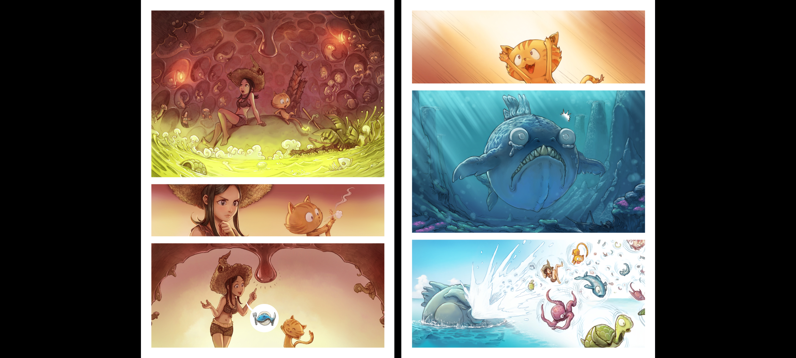</a>

## Library management

<table>
  <tr>
    <td align="center"><a href="screenshots/library-folders.png">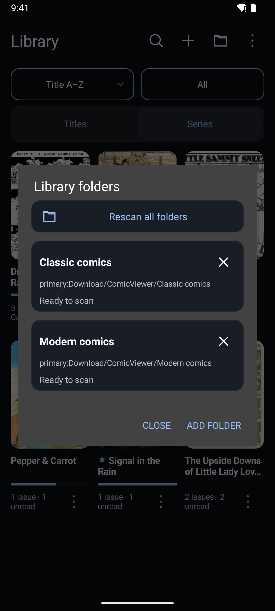</a> Library folders</td>
    <td align="center"><a href="screenshots/edit-comic.png">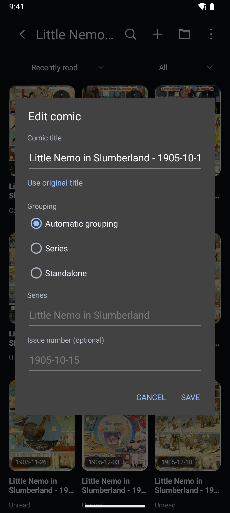</a> Comic details</td>
  </tr>
</table>

## Immersive reading and options

<table>
  <tr>
    <td align="center"><a href="screenshots/immersive-continuous-reading.png">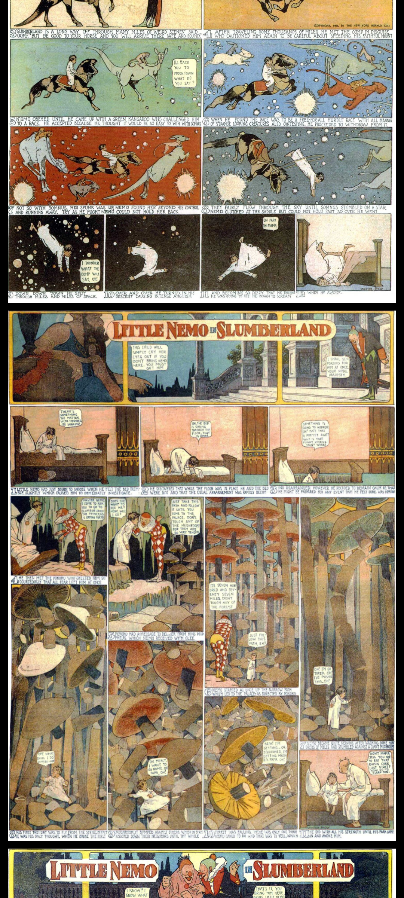</a> Immersive reading</td>
    <td align="center"><a href="screenshots/reader-options.png">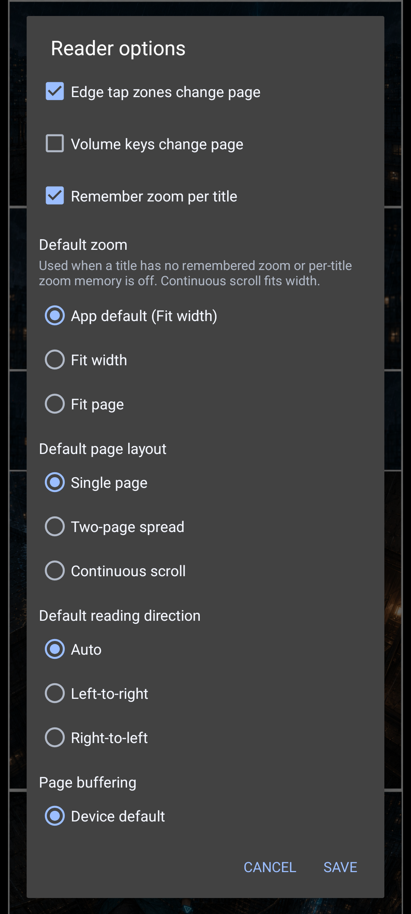</a> Reader options</td>
  </tr>
</table>

See the [user guide](USER_GUIDE.md) for controls and settings, or return to the
[README](../README.md).
